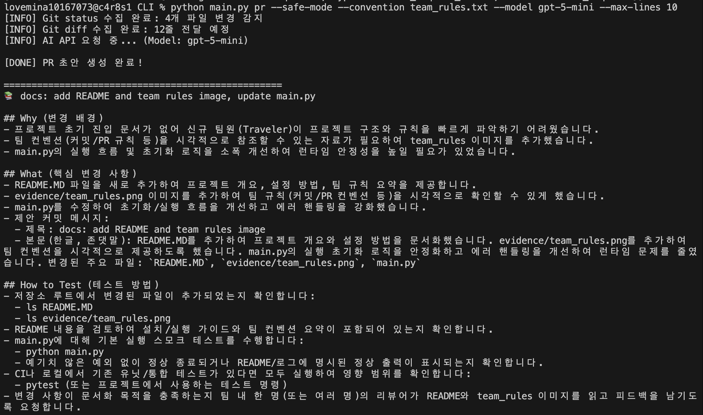
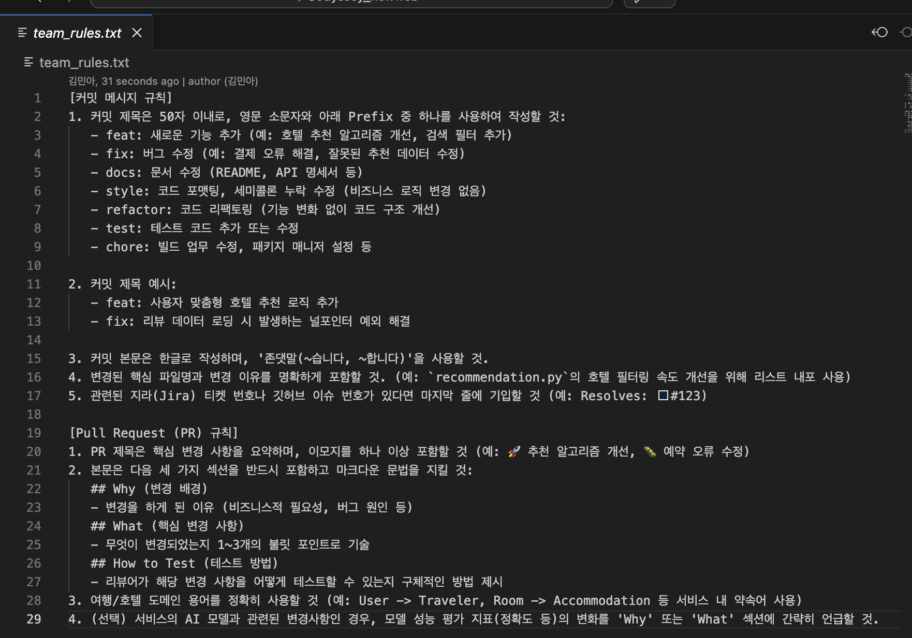
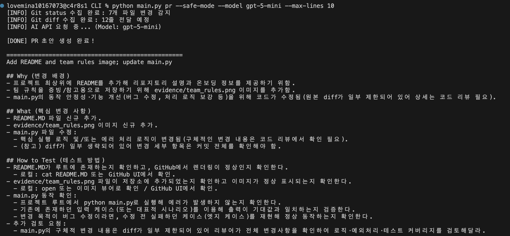
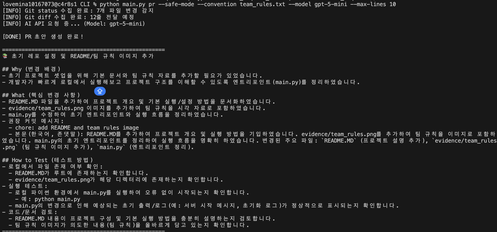

# AI-Powered Git Commit & PR Generator 🚀

> Git 변경 사항(`git status`, `git diff`)을 자동으로 수집하여 의미 있는 커밋 메시지와 Pull Request 초안을 생성해 주는 Python CLI 도구입니다.

## 🛠 1. 설치 및 실행 방법

1. 리포지토리 루트 디렉토리에 `main.py`와 `team_rules.txt` 파일을 위치시킵니다.
2. AI API 키를 환경변수로 설정합니다:
   ```bash
   export AI_API_KEY="여러분의_VIRTUAL_KEY"
   ```
3. 도구를 실행합니다:
   - **커밋 메시지 생성:**
     ```bash
     python main.py commit --model gpt-5-mini
     ```
   - **PR 초안 생성:**
     ```bash
     python main.py pr --model gpt-5-mini --convention team_rules.txt --safe-mode
     ```


- Temperature 변경 테스트
🔥 창의적인 설정(--temperature 1.5)이 더 매력적으로 느껴지는 이유
. 풍부한 표현과 자연스러운 서사:
온도가 낮을(0.1) 때는 AI가 가장 확률이 높은 단어만 기계적으로 골라 쓰기 때문에 문장이 딱딱하고 매뉴얼처럼 굳어지기 쉽습니다. 반면 온도가 높으면 다양한 어휘와 부드러운 연결사를 사용하여 마치 사람이 직접 고민해서 쓴 것 같은 자연스러운 설명이 만들어집니다.

. 배경(Why)과 의도에 대한 윤곽:
단순히 "무엇을 바꿨다"라는 사실 나열을 넘어, 왜 이런 코드를 고치게 되었는지 그 맥락이나 뉘앙스를 조금 더 입체적으로 풀어내는 경향이 있습니다.

. 단조로운 형식 탈피:
매번 비슷비슷하게 찍혀 나오는 기계적인 템플릿 답변에서 벗어나, 커밋이나 PR의 성격에 맞게 어조가 조금씩 살아나면서 읽는 재미와 가독성이 좋아지기 때문입니다.
물론 온도를 너무 높이면 간혹 엉뚱한 소리를 하거나 형식을 벗어날 위험도 있지만, 지금처럼 적절한 프롬프트 규칙(템플릿 제약)이 잘 잡혀 있는 상태라면 약간 높은 온도가 오히려 결과물을 훨씬 사람답고 읽기 좋게 만들어 줍니다.


- Token 변경 테스트

---
## ⚖️ 2-1. 실제 리포지토리에 적용 (보너스 과제 1)


## ⚖️ 2-2. 팀 컨벤션 적용 전후 비교 분석 (보너스 과제 2)
여행/호텔 추천 AI 서비스를 개발하는 팀을 위한 팀 규칙 작성. 서비스의 특성을 반영하여 명확한 커밋 및 PR 컨벤션을 디테일하게 구성함



`team_rules.txt` 파일을 적용(`--convention`)했을 때와 적용하지 않았을 때의 AI 생성 결과 차이점 분석 내용

| 비교 항목 | 컨벤션 미적용 (Default) | 컨벤션 적용 (`--convention team_rules.txt`) |
| :--- | :--- | :--- |
| **1. 문체 및 어조** | 건조한 평어(반말) 및 무뚝뚝한 표현 (`"제공함"`, `"확인한다"`) | 일관된 한국어 존댓말 및 정중한 표현 (`"정리하였습니다"`, `"확인합니다"`) |
| **2. 템플릿 및 추가 제안** | 순수 PR 템플릿 요약 중심 | 본문 내에 **"권장 커밋 메시지"** 하위 항목을 스스로 생성하여 추가 제안 |
| **3. 시각적 요소 및 용어** | 이모지 없음, 전형적인 영문/국문 혼용 개발 스타일 | 상단 제목에 이모지(`📚`) 포함 및 친근하고 직관적인 구성 |
| **4. 예외/제한 상황 인지** | diff가 잘린 경우(`--max-lines`) 리뷰어에게 적극적으로 경고 및 양해 구함 | 잘린 코드에 대한 경고보다는 팀 규칙의 형식과 템플릿 완성도에 집중 |


---

## 🔒 3. 주요 옵션 및 보안 (Safe Mode)

- `--model <model_name>`: 사용할 AI 모델 지정 (기본: `gpt-5-mini`)
- `--convention <file_path>`: 팀 컨벤션 규칙 파일을 불러와 적용
- `--safe-mode`: 정규표현식을 이용한 민감 정보(이메일, API Key 등) 자동 마스킹 (`***[MASKED]***`)
- `--max-lines <number>`: 전송 줄 수 제한을 통한 토큰 절약 및 타임아웃 방지 (기본: 200줄)

## ⚖️ 3-1. 안전 모드 고도화 (보너스 과제 3)
세이프 모드를 끄고 실행했을 때는 AI가 평문 노출된 민감 정보를 실제 보안 사고로 오인하여 깃 히스토리 삭제 및 키 폐기 등 강력한 보안 대응 조치를 PR 본문에 작성한반면, 세이프 모드를 켠(--safe-mode) 상태에서는 정규표현식에 의해 민감 정보가 완벽히 마스킹(***[MASKED]***)되어 전달됨으로써, AI가 보안 사고 우려 없이 안전 모드 정상 작동 여부를 검증하는 테스트 중심으로 깔끔한 PR 초안을 생성

